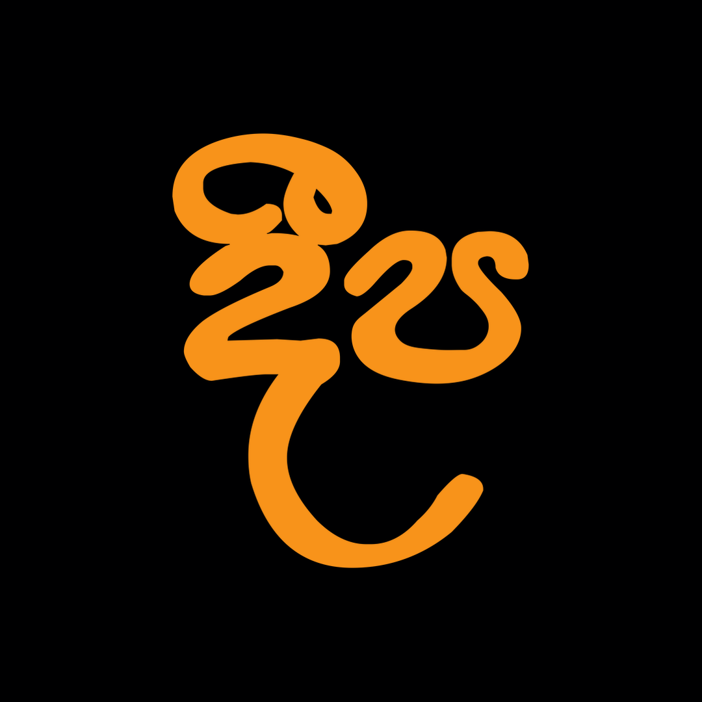

<picture><source media="(prefers-color-scheme: dark)" srcset="./assets/03-wordmark/DeepaLogo_WnO.svg"></picture>

# Brand

The official brand assets and guidelines for **Bitcoin Deepa**, the *Pearl of Satoshi*: logos, the Yaka symbol, app icons, profile pictures, patterns, the colour system and design tokens.

**[Open the brand guidelines →](https://bitcoindeepa.github.io/brand/)** · [Colour system](https://bitcoindeepa.github.io/brand/colour/) · [Download all assets](https://bitcoindeepa.github.io/brand/downloads/bitcoin-deepa-brand-assets.zip)

> **The brand is not open source.** Bitcoin Deepa's code is AGPL-3.0; the files in this repository are reserved trademarks and proprietary assets of Ceylon Cash (PVT) LTD. Use them for official Bitcoin Deepa work or a truthful reference, unmodified. See [LICENSE](./LICENSE) and [TRADEMARK.md](./TRADEMARK.md).

## At a glance

<picture><source media="(prefers-color-scheme: dark)" srcset="./assets/01-primary-logo/BDLogo_White.svg"></picture>

<sub>The primary logo: <b>BDLogo_Black</b> on light grounds, <b>BDLogo_White</b> on dark. This preview follows your GitHub theme.</sub>

**App icon** (`05-app-icon/`): white දීප on Satoshi Orange is the icon; light and dark are alternates.

  

**Profile picture** (`09-profile-picture/`): the same, white දීප on orange, on every account.

  

**The Yaka** (`04-yaka-symbol/`)

<picture><source media="(prefers-color-scheme: dark)" srcset="./assets/04-yaka-symbol/Yaka_LaserEyes.svg"></picture>

## What's here

```
assets/
  01-primary-logo/       Stacked logo: Yaka above "bitcoin දීප" (SVG + PNG)
  02-logo-with-slogan/   Primary logo with "Pearl of Satoshi" (PNG)
  03-wordmark/           Horizontal wordmark, and the wordmark with the ₿ coin
  04-yaka-symbol/        The Yaka: gradient, bold, single colour, half Yaka, laser eyes
  05-app-icon/           දීප app icon: orange (primary), light, dark (1024px)
  06-on-orange/          The only logos for a Satoshi Orange ground
  07-slogan/             "Pearl of Satoshi" artwork
  08-patterns/           Primary ₿ pattern and secondary spiky-tile pattern
  09-profile-picture/    Social profile pictures: දීප on orange (primary), white, black (1080px)
site/
  index.html             The brand guidelines page, published to GitHub Pages
  colour/index.html      The colour system: themes, contrast checks, CSS tokens
  img/                   Preview images used by the pages
design-system/
  README.md              The brand book in text, for designers, developers and AI tools
  tokens.json            Design tokens: colour (light and dark), type, spacing, radius
  tokens.css             The colour tokens as CSS custom properties
  assets/, components/   Notes on each asset group and on using the logo
```

PNG files are transparent and 2400px on the long side unless the folder says otherwise. Use SVG wherever it is accepted.

## Which logo goes where

| Ground | Use |
|---|---|
| White, Paper Wallet Cream, light theme | `01-primary-logo/BDLogo_Black` |
| Black, Cold Storage Charcoal, dark theme | `01-primary-logo/BDLogo_White` |
|  | Satoshi Orange | `06-on-orange/` only |
| Nav bars, footers, under 120px wide | `03-wordmark/DeepaLogo_BnO` (light) or `DeepaLogo_WnO` (dark) |
| App icons and favicons | `05-app-icon/` |
| Social profiles | `09-profile-picture/` |

Keep clear space equal to the height of the "b" in "bitcoin" on every side. Never recolour, stretch, redraw or retype the logo. The full rules are in the [brand guidelines](https://bitcoindeepa.github.io/brand/#logo).

## Colours

| | Name | Hex | Role |
|---|---|---|---|
| Satoshi Orange | `#F8931A` | The brand colour |
|  | Genesis Black | `#000001` | Wordmark and dark ground |
|  | Whitepaper White | `#FFFFFE` | Wordmark and light ground |
|  | Cold Storage Charcoal | `#1D1E1D` | Lightning card and printed product |
|  | Paper Wallet Cream | `#FFFCFA` | Decks and documents |
|  | Perahera Maroon | `#8D183A` | Secondary pattern, headlines on cream |
|  | Sinharaja Green | `#00544F` | Secondary pattern |
|  | Vesak Gold | `#FFBE2B` | Secondary pattern |
|  | Thambili Orange | `#EA7400` | Secondary pattern |

The light and dark theme tokens for the app and websites are in [`design-system/tokens.json`](./design-system/tokens.json) and [`design-system/tokens.css`](./design-system/tokens.css). Text on Satoshi Orange is always black. Buttons are solid fills, never outlines.

## Using the assets

- **Download one file:** open it on GitHub and choose *Download raw file*.
- **Download everything:** from the brand site: [all assets](https://bitcoindeepa.github.io/brand/downloads/bitcoin-deepa-brand-assets.zip), [SVG only](https://bitcoindeepa.github.io/brand/downloads/bitcoin-deepa-brand-assets-svg.zip) or [PNG only](https://bitcoindeepa.github.io/brand/downloads/bitcoin-deepa-brand-assets-png.zip). Each release also has a zip attached.
- **Link from a website:** every asset is also served from the brand site, for example `https://bitcoindeepa.github.io/brand/assets/01-primary-logo/BDLogo_Black.svg`. That URL always serves the current version.
- **Link from code:** pin to a release tag, not `main`, so artwork doesn't change under you:
  `https://raw.githubusercontent.com/bitcoindeepa/brand/v1.0.0/assets/01-primary-logo/BDLogo_Black.svg`
- **Read the guidelines:** on the [brand site](https://bitcoindeepa.github.io/brand/). To preview a change before it merges, run `./scripts/build-site.sh` and open `_site/index.html`, or serve `_site/` with any static server.
- **Design tokens:** copy `design-system/tokens.css` into a project, or read `tokens.json` in a build step.

## The brand site

[`https://bitcoindeepa.github.io/brand/`](https://bitcoindeepa.github.io/brand/) is built from this repository by [`.github/workflows/pages.yml`](./.github/workflows/pages.yml) every time `main` changes under `site/`, `assets/` or `design-system/`. The build ([`scripts/build-site.sh`](./scripts/build-site.sh)) copies the pages and assets and makes the three download zips, so the site never needs editing by hand. It is the page that [TRADEMARK.md](./TRADEMARK.md) and the licence call the brand guidelines; `bitcoindeepa.com/brand` should point to it.

## Releases and versions

Each release is tagged `vMAJOR.MINOR.PATCH` and recorded in [CHANGELOG.md](./CHANGELOG.md):

- **MAJOR:** a mark changes or is withdrawn (a redrawn logo, a new brand colour value). Anyone using the old files must update.
- **MINOR:** something is added (a new asset, a new theme, a new guideline section).
- **PATCH:** fixes that don't change how the brand looks (a cleaner export, a typo, a broken link).

To cut a release, a brand owner moves the **Unreleased** notes in the changelog under the new version, tags the merge commit on `main`, and attaches a zip of `assets/` to the GitHub release.

## Source control

- `main` is protected: changes go through pull requests with at least one approval from a brand owner (see [.github/CODEOWNERS](./.github/CODEOWNERS)), and no force pushes.
- Branch names describe the change: `asset/…`, `guideline/…`, `colour/…`, `fix/…`.
- Every commit is signed off under the [Developer Certificate of Origin](https://developercertificate.org/) (`git commit -s`).
- Artwork is stored as binary: [`.gitattributes`](./.gitattributes) stops Git from diffing or merging PNG files and from changing line endings in SVG files. If two branches change the same file, keep one version and re-export; never hand-merge artwork.
- Master files (Illustrator and Figma) stay with the design team; this repository holds the approved exports.

How to propose a change is in [CONTRIBUTING.md](./CONTRIBUTING.md).

## Licence

Copyright © 2026 Ceylon Cash (PVT) LTD. All rights reserved.

The Bitcoin Deepa name, "Pearl of Satoshi", the Yaka mask, the දීප glyph mark, the logos, icons, patterns and colour system are trademarks and proprietary assets of Ceylon Cash (PVT) LTD and are licensed only under the [Bitcoin Deepa Brand Assets Licence](./LICENSE). They are not covered by the AGPL-3.0 licence of Bitcoin Deepa's software. For permission beyond the licence, write to **hello@bitcoindeepa.com**.

<p align="center">
  <a href="https://bitcoindeepa.com">Website</a> ·
  <a href="https://t.me/BitcoinDeepa">Telegram</a> ·
  <a href="https://github.com/bitcoindeepa">GitHub</a>
</p>

<p align="center"><sub>Bitcoin Deepa is a community initiative of CeylonCash.</sub></p>
